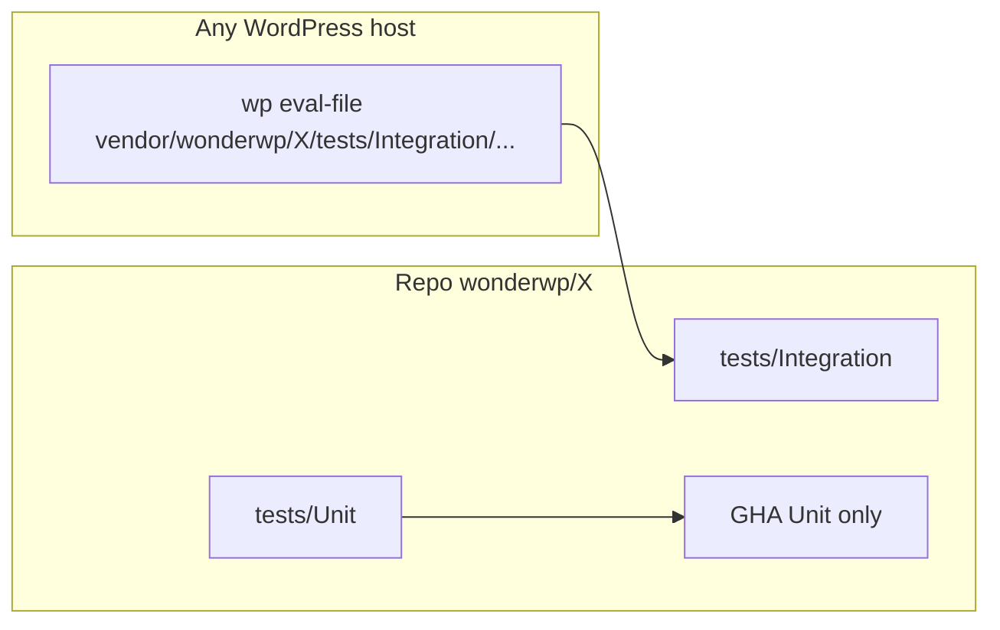

# Testing WonderWP packages

This document is the canonical testing strategy for every `wonderwp/*` Composer package.

Reference implementations:

- [`wonderwp/api`](https://github.com/wonderwp/API) — Unit spies + Integration smoke (REST attributes)
- [`wonderwp/repository`](https://github.com/wonderwp/Repository) — Unit spies + Integration smoke (`get_terms`)

## Two test kinds, same package repo



| | **Unit** | **Integration** |
|--|----------|-----------------|
| **Location** | `tests/Unit/` in the package | `tests/Integration/` in the **same** package |
| **Package CI (GitHub Actions)** | Yes — merge gate | No (not on `push` CI) |
| **How to run** | `composer test` | From any WP project that requires the package: `wp eval-file vendor/wonderwp/<pkg>/tests/Integration/<smoke>.php` |
| **WordPress** | Runtime stubs / spies only | Real WordPress + database of the **host** project |
| **Host coupling** | None | No files in a specific host repo (e.g. wonderwp-base); only the host **runtime** matters |

### Important constraints

- **`johnpbloch/wordpress` in `require-dev` is not a running WordPress.** Composer drops core PHP files; there is no `wp-config`, no MySQL, no booted REST server. It is **not** enough for real Integration tests.
- **`php-stubs/wordpress-stubs`** is for **static analysis / IDE** only. It does **not** replace Unit spies (e.g. capturing `get_terms` arguments).
- Integration tests must **not** live only in a host project such as wonderwp-base. They ship with the package and run from **any** WordPress install that has the package via Composer.

## Commands

### Unit (CI) — one package

```bash
# From the package root (after composer install), or via a host autoload:
composer test
# equivalent:
vendor/bin/phpunit --configuration phpunit.xml.dist
```

`phpunit.xml.dist` must point at **`tests/Unit` only**.

### Integration — one package (any WordPress host)

```bash
# From the WordPress project root (Bedrock, classic, DDEV, …):
wp eval-file vendor/wonderwp/<package>/tests/Integration/<smoke>.php

# DDEV example:
ddev wp eval-file vendor/wonderwp/<package>/tests/Integration/<smoke>.php
```

Rules for Integration scripts:

1. Require WordPress already loaded (`defined('ABSPATH')`) or fail with a clear message.
2. Resolve the **host** Composer autoload (`vendor/autoload.php`), not only a package-local vendor tree.
3. Do not hardcode a host project name or absolute paths.
4. Fail clearly if the package is not autoloadable.

### All packages (meta runners)

Shipped in this meta-package under [`bin/`](../bin/). They discover every installed sibling `wonderwp/*` under `vendor/wonderwp/`.

**Unit — every package with `phpunit.xml.dist`:**

```bash
# From the host project (DDEV recommended when host PHP < platform req):
ddev exec bash vendor/wonderwp/wonderwp/bin/run-all-unit.sh

# Or via Composer when developing the meta package itself:
composer test:all-unit
```

**Integration — every `tests/Integration/smoke-*.php`:**

```bash
# Inside DDEV (wp available):
ddev exec bash vendor/wonderwp/wonderwp/bin/run-all-integration.sh

# From the host with DDEV WP-CLI:
WP_BIN="ddev wp" bash vendor/wonderwp/wonderwp/bin/run-all-integration.sh

# Limit to one package:
ONLY=repository WP_BIN="ddev wp" bash vendor/wonderwp/wonderwp/bin/run-all-integration.sh
```

| Env | Role |
|-----|------|
| `PHPUNIT` | Override phpunit binary (Unit runner) |
| `PHP_BIN` | Override PHP binary (Unit runner) |
| `FILTER` | PHPUnit `--filter` applied to each package (Unit) |
| `WP_BIN` | WP-CLI invocation (`wp`, `ddev wp`, …) |
| `ONLY` | Package short name filter (Integration) |
| `NO_COLOR` | Disable ANSI colors |
| `FORCE_COLOR` | Force colors even when stdout is not a TTY |

## Package checklist (scaffold / migration)

1. `require-dev`: `phpunit/phpunit: ^12`
2. `phpunit.xml.dist` → suite `tests/Unit` only
3. `tests/bootstrap.php` + runtime stubs/spies as needed (`tests/stub-*.php`)
4. `.github/workflows/ci.yml` → checkout, PHP 8.3, `composer install`, `composer test`
5. Package `README.md`: **Testing** sections (Unit + Integration when applicable)
6. If critical real-WP behaviour: smoke under `tests/Integration/`
7. Script `"test": "phpunit --configuration phpunit.xml.dist"` in `composer.json`

Packages that are pure PHP (no WordPress side effects) only need Unit tests — Integration is optional.

Typical layout:

```
phpunit.xml.dist
.github/workflows/ci.yml
tests/
  bootstrap.php
  stub-wordpress.php          # runtime spies when needed
  Unit/
    SomethingTest.php
  Integration/                # optional
    smoke-something.php
  Fixtures/                   # optional
```

## Rollout waves (all `wonderwp/*` packages)

Aligned with the framework deps-max effort: ruptures first, then the rest.

### T0 — Meta documentation

| Package | Status |
|---------|--------|
| `wonderwp` (this repo) | Done — this document + README |

### T1 — Deps wave 3 (ruptures)

| Package | Target | Status |
|---------|--------|--------|
| `api` | Unit + Integration + CI | Done |
| `repository` | Unit + Integration + CI | Done (tests PR) |
| `asset` | README Testing + Integration smoke; keep CI | Done |
| `service` | Add GHA CI (Unit already exists) | Done |
| `hook` | Scaffold Unit + CI | Done |
| `media` | Scaffold Unit + CI | Done |
| `routing` | Scaffold Unit + CI (legacy tests → Unit) | Done |

### T2 — Aggregators (deps waves 4–5)

| Package | Target | Status |
|---------|--------|--------|
| `search` | Minimal Unit + CI | Done |
| `plugin-skeleton` | Minimal Unit + CI | Done |
| `wonderwp` (meta) | Modernise legacy tests → Unit + CI | Done (Unit scaffold; legacy bootstrap retained) |

### T3 — Legacy tests without scaffold

Normalise into `tests/Unit/`, add `phpunit.xml.dist`, `composer test`, CI:

`http-foundation` → `form` → `sanitizer` → `functions` → `dependency-injection` → `notification` → `mailing`

| Package | Status |
|---------|--------|
| `http-foundation` | Done |
| `sanitizer` | Done |
| `form` | Done |
| `functions` | Done |
| `dependency-injection` | Done |
| `notification` | Done |
| `mailing` | Done |

### T4 — No tests yet

Minimal Unit (at least one smoke on a public entry point) + CI:

`http` → `cache` → `panel` → `taxonomy` → `customposttype` → `custom-fields` → `response` → `filter` → `logging` → `shortcode` → `task` → `template` → `block-bindings-source` / `block-style` / `block-type` / `block-variations`

| Package | Status |
|---------|--------|
| `http` | Done |
| `cache` | Done |
| `panel` | Done |
| `taxonomy` | Done (prior wave) |
| `customposttype` | Done (prior wave) |
| `custom-fields` | Done (prior wave) |
| `response` | Done |
| `filter` | Done |
| `logging` | Done |
| `shortcode` | Done |
| `task` | Done |
| `template` | Done |
| `block-bindings-source` | Done |
| `block-style` / `block-type` / `block-variations` | Pending (optional smoke) |

## Coverage matrix (snapshot)

| Maturity | Packages |
|----------|----------|
| **Reference** (Unit + Integration + CI) | `api`, `repository` (Taxonomy + Post/User), `asset`, `customposttype`, `taxonomy` |
| **Unit + CI** (Integration optional / N/A) | `service`, `hook`, `media`, `routing`, `cache`, `search`, `plugin-skeleton`, `sanitizer`, `http-foundation`, `form`, `functions`, `dependency-injection`, `notification`, `mailing`, `http`, `panel`, `response`, `filter`, `logging`, `shortcode`, `task`, `template`, `taxonomy`, `customposttype`, `custom-fields`, `block-bindings-source`, `wonderwp` (meta Unit + legacy bootstrap) |
| **Partial / pending** | `block-style`, `block-type`, `block-variations` (no Unit scaffold yet) |

Update this matrix when a package graduates (PR `test:` or deps PR).

## Contributing tests

Prefer adding or extending Unit tests in the package under change. Follow the checklist above. For behaviour that only makes sense with a real database or REST stack, add a portable Integration smoke in that same package.
